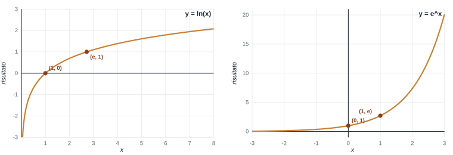

# Esercitazione 3 - 12/10

Argomenti:

- funzioni matematiche (`Math.log`, `Math.exp`, `Math.abs`) e `Number.isInteger`
- ciclo `do ... while` (e differenza dal `while`): validare l'input
- l'operatore `x++`
- cicli e variabili flag (`true` / `false`): numeri primi
- `switch` e operatore ternario `? :`
- cicli annidati: fattoriale e serie di Taylor
- `break` e metodi iterativi

## Indice degli esercizi

| Esercizio | Argomento |
| --------- | --------- |
| [Esercizio 1](#esercizio-1-cosa-stampa-x) | Operatore ++ |
| [Esercizio 2](#esercizio-2-contatori-con-x) | Operatore ++ e ciclo while |
| [Esercizio 3](#esercizio-3-cosa-stampa-while-e-do-while) | Ciclo while e do-while |
| [Esercizio 4](#esercizio-4-logaritmo-ed-esponenziale) | Funzioni matematiche |
| [Esercizio 5](#esercizio-5-numero-intero-compreso-tra-1-e-100) | Do-while e validazione dell'input |
| [Esercizio 6 (★ 3.1)](#esercizio-6-31-logaritmo-in-base-a-con-controllo) | Do-while e funzioni matematiche |
| [Esercizio 7 (★ 3.2)](#esercizio-7-32-numero-primo) | Variabili flag (numeri primi) |
| [Esercizio 8 (★ 3.3)](#esercizio-8-33-tabella-di-conversione) | Ciclo for |
| [Esercizio 9](#esercizio-9-switch-cosa-stampa-e-completa) | Switch |
| [Esercizio 10 (★ 3.4)](#esercizio-10-34-il-nome-del-mese) | Switch |
| [Esercizio 11](#esercizio-11-completa-loperatore-ternario) | Operatore ternario |
| [Esercizio 12](#esercizio-12-tabella-dei-fattoriali) | Cicli annidati |
| [Esercizio 13 (★ 3.5)](#esercizio-13-35-serie-di-taylor-del-seno) | Cicli annidati |
| [Esercizio 14](#esercizio-14-quando-fermarsi) | Break |
| [Esercizio 15](#esercizio-15-approssimazioni-successive) | Metodi iterativi |
| [Esercizio 16 (★ 3.6)](#esercizio-16-36-equazione-non-lineare) | Metodi iterativi |

## Come si lavora

- Ogni esercizio del foglio (3.1 – 3.6) è preceduto da **esercizi preparatori**, di difficoltà crescente
- Si parte con alcune domande **"cosa stampa?"** (`x++`, `while` e `do ... while`, `switch`)
- Brevi **Recap** pratici, alternati agli esercizi
- Svolgiamo alcuni esercizi insieme (io scrivo il codice live, voi fate lo stesso)
- Esercizi svolti da voi in autonomia
- Domande

Le regole sono le stesse delle volte scorse:

- **provare** prima di rinunciare
- **commenti** dove il codice non parla da solo
- eseguite **sempre** il programma con più valori, compresi i casi "strani" (0, numeri negativi, decimali).

Gli esercizi con il simbolo ★ sono quelli del foglio di esercitazione; gli altri servono per arrivarci un passo alla volta.

## Esercizio 1 · Cosa stampa? (`x++`)

`x++` **aumenta** `x` di 1, come `x = x + 1`. Come espressione, `x++` vale il valore **di prima** dell'aumento.

**A.** Senza eseguirlo, cosa stampa?

```js
let x = 5;
x++;
x++;
console.log(x);
```

**B.** Cosa stampano `x` e `somma`? Attenzione a dove compare `x++`.

```js
let x = 1;
let somma = 0;
while (x <= 4) {
  somma = somma + x++;
}
console.log(x, somma);
```

**C.** Cosa stampa? Quante volte gira il ciclo?

```js
let i = 0;
while (i < 3) {
  console.log(i);
  i++;
}
console.log("fine", i);
```

<details>
<summary>Soluzione</summary>

**A.** Stampa `7`: ogni `x++` aggiunge 1.

**B.** Stampa `5 10`. Dentro l'espressione `somma + x++`, `x++` vale il valore **di prima**: `somma` accumula `1 + 2 + 3 + 4 = 10`, mentre `x` aumenta di 1 a ogni giro e finisce a 5 (il valore che rende falsa la condizione). Da solo (`x++;`) è semplicemente `x = x + 1`; dentro un'altra istruzione bisogna stare attenti all'ordine.

**C.** Stampa `0`, `1`, `2` e infine `fine 3`: il ciclo gira 3 volte, e alla fine `i` vale 3 (il valore che rende falsa la condizione).

</details>

## Esercizio 2 · Contatori con `x++`

Il programma legge numeri finché l'utente non inserisce `0`, e alla fine stampa **quanti numeri** sono stati inseriti (lo `0` escluso) e **quanti** di essi erano **positivi**. Completate (al posto di `______`) la condizione del ciclo, le due istruzioni con `++` e la condizione dell'`if`:

```js
let totale = 0;
let positivi = 0;
let x_input = prompt("Numero (0 per terminare):");
let x = Number(x_input);
while (______) {
  ______;                                   // un numero in più
  if (______) {
    ______;                                 // un positivo in più
  }
  x_input = prompt("Numero (0 per terminare):");
  x = Number(x_input);
}
console.log("Inseriti:", totale, "positivi:", positivi);
```

<details>
<summary>Soluzione</summary>

```js
let totale = 0;
let positivi = 0;
let x_input = prompt("Numero (0 per terminare):");
let x = Number(x_input);
while (x != 0) {
  totale++;                                 // un numero in più
  if (x > 0) {
    positivi++;                             // un positivo in più
  }
  x_input = prompt("Numero (0 per terminare):");
  x = Number(x_input);
}
console.log("Inseriti:", totale, "positivi:", positivi);
```

`totale++` e `positivi++` sono **contatori**: partono da `0` e aumentano di 1 ogni volta che succede qualcosa. `positivi++` sta dentro l'`if`, `totale++` no. Il valore letto viene aggiornato **alla fine** di ogni giro; se il primo numero è `0` il ciclo non parte e il risultato è `0` e `0`. Provate `5, -2, 3, 0`: `Inseriti: 3 positivi: 2`.

</details>

## Recap 1 · Il ciclo `do ... while`

Nel `while` la condizione viene controllata **prima** di eseguire il corpo. Nel `do ... while` il corpo viene eseguito **almeno una volta**, e la condizione si controlla **dopo**:

```js
let x;
do {
  let x_input = prompt("Inserisci un numero positivo:");
  x = Number(x_input);
} while (x <= 0);                       // si ripete finché il valore NON è valido
console.log("Hai inserito:", x);
```

- se la condizione è falsa fin dall'inizio, `while` **non esegue mai** il corpo, `do ... while` lo esegue **una volta**;
- è il ciclo ideale per **chiedere un valore e ripetere la domanda** se è sbagliato: non serve leggere l'input due volte (prima del ciclo e dentro);
- la variabile (`x`) va dichiarata **prima** del `do`: se la dichiarate dentro le graffe, la condizione del `while` non la vede;
- la condizione descrive il caso **sbagliato**, come nel `while`;
- si ricorda il `;` dopo la parentesi del `while`.

## Esercizio 3 · Cosa stampa? (`while` e `do ... while`)

Per ogni programma, dite cosa stampa **senza eseguirlo**.

**A.** La condizione è vera all'inizio:

```js
let n = 1;
while (n <= 3) {
  console.log("giro", n);
  n++;
}
```

**B.** La condizione è falsa **fin dall'inizio**: cambia qualcosa tra i due cicli?

```js
let n = 10;
while (n < 5) {
  console.log("while");
  n++;
}
do {
  console.log("do-while");
  n++;
} while (n < 5);
console.log(n);
```

**C.** Completate (al posto di `______`) la **parola chiave** e la **condizione**, in modo che il programma chieda un numero e lo richieda finché non è **positivo**:

```js
let x;
______ {
  let x_input = prompt("Numero positivo:");
  x = Number(x_input);
} ______ (______);
```

<details>
<summary>Soluzione</summary>

**A.** Stampa `giro 1`, `giro 2`, `giro 3`.

**B.** Stampa `do-while` e poi `11`: il `while` controlla la condizione **prima** e non esegue mai il corpo; il `do ... while` esegue il corpo **una volta** e controlla **dopo**. Quindi la differenza si vede solo quando la condizione è falsa fin dall'inizio.

**C.**

```js
let x;
do {
  let x_input = prompt("Numero positivo:");
  x = Number(x_input);
} while (x <= 0);
```

La condizione descrive il caso **sbagliato** (`x <= 0`): il ciclo si ripete finché il valore non va bene. Il `do ... while` è ideale qui, perché la domanda va fatta **almeno una volta**.

</details>

## Recap 2 · Funzioni matematiche

| Strumento | Cosa fa | Esempio |
| --------- | ------- | ------- |
| `Math.log(x)` | logaritmo **naturale** (in base *e*), `x > 0` | `Math.log(1)` → `0` |
| `Math.exp(x)` | *e* elevato a *x* | `Math.exp(0)` → `1` |
| `Math.abs(x)` | valore assoluto | `Math.abs(-3)` → `3` |
| `Math.sqrt(x)` | radice quadrata | `Math.sqrt(9)` → `3` |
| `Math.sin(x)` | seno (*x* in radianti) | `Math.sin(0)` → `0` |
| `x ** y` | *x* elevato a *y* | `2 ** 3` → `8` |
| `Number.isInteger(x)` | `true` se *x* è un numero intero | `Number.isInteger(2.5)` → `false` |

Una funzione si usa **scrivendo il suo nome** e, tra parentesi, il valore su cui lavora. Il risultato si può salvare in una variabile oppure stampare direttamente.

## Esercizio 4 · Logaritmo ed esponenziale

Leggere un numero `x` e stampare, su due righe, il suo logaritmo naturale e *e* elevato a `x`. Con `x = 1`:

```text
ln(x): 0
exp(x): 2.718281828459045
```

I due grafici mostrano come si comportano le funzioni:



- `ln(x)` esiste solo per `x > 0`; vale `0` in `x = 1`, è negativa tra 0 e 1 e cresce lentamente; avvicinandosi a 0 scende verso `-Infinity`;
- `e^x` è sempre positiva; vale `1` in `x = 0` ed è `e` ≈ 2.718 in `x = 1`; cresce sempre più in fretta;
- sono una l'**inversa** dell'altra: `Math.log(Math.exp(x))` torna `x`.

<details>
<summary>Soluzione</summary>

```js
let x_input = prompt("x:");
let x = Number(x_input);
console.log("ln(x):", Math.log(x));
console.log("exp(x):", Math.exp(x));
```

Provate `x = 0` (il logaritmo vale `-Infinity`) e `x = -1` (il risultato è `NaN`): il logaritmo è definito solo per valori **positivi**. Per questo, nell'esercizio ★ 6, dovremo controllare l'input.

</details>

## Esercizio 5 · Numero intero compreso tra 1 e 100

Con un `do ... while`, chiedere all'utente un numero **intero compreso tra 1 e 100** (estremi inclusi) e ripetere la domanda finché non è valido. Alla fine stampare il numero.

Suggerimento: `Number.isInteger(x)` è `true` se `x` è intero; per il caso sbagliato usate `!` e `||`.

<details>
<summary>Soluzione</summary>

```js
let n;
do {
  let n_input = prompt("Inserisci un intero tra 1 e 100:");
  n = Number(n_input);
} while (n < 1 || n > 100 || !Number.isInteger(n));
console.log("Hai inserito:", n);
```

Il valore è sbagliato se è **troppo piccolo**, **oppure** troppo grande, **oppure** non intero: tre casi uniti da `||`. Provate `2.5`, `0`, `101`, `abc` (che `Number` trasforma in `NaN`: `Number.isInteger(NaN)` è `false`, quindi viene scartato).

</details>

## Esercizio 6 · ★ 3.1 Logaritmo in base *a* con controllo

Sapendo che log_a(b) = ln(b) / ln(a), scrivere un programma che legga due numeri `a` e `b` e stampi il valore di log_a(b). Una volta inseriti `a` e `b`, verificare che `a` sia un **intero maggiore di 1** e `b` sia un **reale positivo**. Se così non fosse, far **ripetere l'inserimento di entrambi** i valori all'utente. Alla fine stampare il risultato. Con `a = 2` e `b = 8` il risultato è `3`.

Suggerimento: usate `Math.log` (esercizio 4) per il logaritmo e il `do ... while` dell'esercizio 5 per ripetere l'input.

<details>
<summary>Soluzione</summary>

```js
let a, b;
do {
  let a_input = prompt("Inserire a (intero, maggiore di 1):");
  a = Number(a_input);
  let b_input = prompt("Inserire b (positivo):");
  b = Number(b_input);
} while (a <= 1 || !Number.isInteger(a) || b <= 0);
let risultato = Math.log(b) / Math.log(a);
console.log("log_a(b) =", risultato);
```

Si chiedono **entrambi** i valori dentro lo stesso ciclo, e la condizione unisce con `||` tutti i casi sbagliati. Con `a = 2` e `b = 8` il risultato è `3`; con `a = 2.5` si ricomincia da capo, anche se `b` era corretto.

Attenzione: se `b` non è un numero (ad esempio `abc`), `Number` dà `NaN`, e `NaN <= 0` è `false`: l'input verrebbe accettato! Per evitarlo si può scrivere `!(b > 0)` al posto di `b <= 0`.

</details>

## Recap 3 · Variabili flag

Una variabile booleana può "ricordare" se, durante un ciclo, è successo qualcosa:

Esempio: l'utente inserisce 5 numeri; vogliamo sapere se **tra questi c'è uno zero**.

```js
let zero_presente = false;              // ipotesi iniziale: non c'è nessuno zero
for (let i = 1; i <= 5; i++) {
  let x_input = prompt("Numero " + i + ":");
  let x = Number(x_input);
  if (x == 0) {
    zero_presente = true;               // trovato uno zero: alzo il flag
  }
}
console.log("C'è almeno uno zero:", zero_presente);
```

Con `3, 7, 0, 4, 9` stampa `true`; con `3, 7, 2, 4, 9` stampa `false`. Con `0, 5, 0, 1, 0` stampa ancora `true` (una volta sola): il flag dice **se** è successo, non **quante volte**.

- si parte da un'**ipotesi** (`false`, oppure `true`);
- nel ciclo si **cambia** il valore solo se si trova un caso che smentisce l'ipotesi;
- il flag **non torna indietro**: una volta cambiato, nessun altro giro la rimette com'era;
- il risultato si usa **dopo** il ciclo.

## Esercizio 7 · ★ 3.2 Numero primo

Un numero intero `N > 1` è **primo** se è divisibile solo per 1 e per se stesso. Scrivere un programma che legga `N` e stampi se è primo oppure no.

Una volta letto `N`, verificare che sia un **intero maggiore di 1**. Se così non fosse, far ripetere l'inserimento.

Suggerimento: ipotizzate che `N` sia primo (`true`) e provate tutti i numeri da 2 a `N - 1`: se ne trovate uno che divide `N`, l'ipotesi è smentita. Riusate il `do ... while` dell'esercizio 5 per l'input.

<details>
<summary>Soluzione</summary>

```js
let N;
do {
  let N_input = prompt("Inserire un intero maggiore di 1:");
  N = Number(N_input);
} while (N <= 1 || !Number.isInteger(N));
let primo = true;                   // ipotesi: N è primo
for (let i = 2; i < N; i++) {
  if (N % i == 0) {
    primo = false;                  // ho trovato un divisore: non è primo
  }
}
console.log("N è un numero primo?", primo);
```

Il ciclo parte da 2 (il divisore 1 non conta) e finisce a `N - 1` (nemmeno `N` conta): per questo `i < N`. Provate `2` (primo, il ciclo non gira), `9`, `13`, `15`.

Una versione più efficiente: appena si trova un divisore, si può uscire dal ciclo con `break`, di cui parliamo più avanti.

</details>

## Esercizio 8 · ★ 3.3 Tabella di conversione

La formula per convertire gradi Celsius `C` in gradi Fahrenheit `F` è F = 32 + (9/5) · C. Visualizzare la tabella di conversione da Celsius a Fahrenheit per l'intervallo **50 – 60 °C** con passi di un grado, nel formato:

```text
50°C = 122°F
51°C = 123.8°F
...
```

<details>
<summary>Soluzione</summary>

```js
let F;
for (let C = 50; C <= 60; C++) {
  F = 32 + 9 / 5 * C;
  console.log(C + "°C = " + F + "°F");
}
```

Il `for` fa variare `C` (qui il ciclo parte da 50, non da 1, e finisce a 60 **incluso**, per questo `<=`), il corpo applica la formula.

Varianti da provare: la tabella da 0 a 100 con passi di 10 (`C = C + 10` al posto di `C++`) e la tabella al contrario, da 60 a 50 (`C--` con la condizione `C >= 50`).

</details>

## Recap 4 · L'istruzione `switch`

Quando una variabile può avere **tanti valori fissi** e per ognuno si fa una cosa diversa, `switch` è più leggibile di una lunga catena di `if` / `else if`:

```js
let giorno = 3;
let nome;
switch (giorno) {
  case 1:
    nome = "lunedì";
    break;
  case 2:
    nome = "martedì";
    break;
  default:
    nome = "altro giorno";
}
console.log(nome);
```

- si confronta il valore tra parentesi con ogni `case` (confronto di **uguaglianza**);
- `break` termina lo `switch`: **senza** `break`, l'esecuzione "cade" nel `case` successivo;
- `default` è facoltativo e si esegue se nessun `case` corrisponde.

Equivale a:

```js
if (giorno == 1) {
  nome = "lunedì";
} else if (giorno == 2) {
  nome = "martedì";
} else {
  nome = "altro giorno";
}
```

## Esercizio 9 · `switch`: cosa stampa e completa

**A.** Senza eseguirlo, cosa stampa questo programma?

```js
let v = 2;
switch (v) {
  case 1:
    console.log("uno");
  case 2:
    console.log("due");
  case 3:
    console.log("tre");
    break;
  default:
    console.log("altro");
}
```

**B.** Il programma legge un numero da 1 a 3 e stampa il nome del semaforo corrispondente: `1` → `rosso`, `2` → `giallo`, `3` → `verde`, qualsiasi altro valore → `spento`. Completate (al posto di `______`).

```js
let n_input = prompt("Numero da 1 a 3:");
let n = Number(n_input);
let colore;
switch (______) {
  case 1:
    colore = "rosso";
    ______;
  case 2:
    colore = "giallo";
    break;
  case 3:
    colore = "verde";
    break;
  ______:
    colore = "spento";
}
console.log(colore);
```

<details>
<summary>Soluzione</summary>

**A.** Stampa `due` e poi `tre`: senza `break`, lo `switch` entra nel `case 2` e prosegue nel `case 3`, fermandosi al suo `break`. `uno` e `altro` non vengono stampati.

**B.**

```js
let n_input = prompt("Numero da 1 a 3:");
let n = Number(n_input);
let colore;
switch (n) {
  case 1:
    colore = "rosso";
    break;
  case 2:
    colore = "giallo";
    break;
  case 3:
    colore = "verde";
    break;
  default:
    colore = "spento";
}
console.log(colore);
```

Provate a **togliere** un `break`: con `n = 1` e il `break` mancante nel primo `case`, il programma stampa `giallo`, perché dopo aver eseguito `colore = "rosso"` prosegue con il `case 2`. Nell'ultimo ramo (`default`) il `break` non serve.

</details>

## Esercizio 10 · ★ 3.4 Il nome del mese

Realizzare un programma che, ricevuto in input un numero `N` compreso tra 1 e 12 (estremi inclusi), stampi il corrispondente **mese dell'anno**: con `1` stampi `gennaio`, con `2` `febbraio`, e così via.

Prima di tutto verificare che `N` sia un **numero intero compreso tra 1 e 12**; se così non fosse, far ripetere l'inserimento.

Usare l'istruzione `switch`; poi **riscrivere** il programma con `if` / `else if` / `else`.

<details>
<summary>Soluzione (con switch)</summary>

```js
let mese;
do {
  let mese_input = prompt("Introduci un intero tra 1 e 12:");
  mese = Number(mese_input);
} while (mese < 1 || mese > 12 || !Number.isInteger(mese));
let nome;
switch (mese) {
  case 1:
    nome = "gennaio";
    break;
  case 2:
    nome = "febbraio";
    break;
  case 3:
    nome = "marzo";
    break;
  case 4:
    nome = "aprile";
    break;
  case 5:
    nome = "maggio";
    break;
  case 6:
    nome = "giugno";
    break;
  case 7:
    nome = "luglio";
    break;
  case 8:
    nome = "agosto";
    break;
  case 9:
    nome = "settembre";
    break;
  case 10:
    nome = "ottobre";
    break;
  case 11:
    nome = "novembre";
    break;
  default:
    nome = "dicembre";
}
console.log("mese =", nome);
```

L'input è già stato validato (esercizio 5), quindi l'ultimo ramo può essere il `default`: se non è nessuno degli altri 11, è dicembre. In alternativa si può scrivere `case 12:` e un `default` con un messaggio di errore.

</details>

<details>
<summary>Soluzione (con if / else if / else)</summary>

```js
let mese;
do {
  let mese_input = prompt("Introduci un intero tra 1 e 12:");
  mese = Number(mese_input);
} while (mese < 1 || mese > 12 || !Number.isInteger(mese));
let nome;
if (mese == 1) {
  nome = "gennaio";
} else if (mese == 2) {
  nome = "febbraio";
} else if (mese == 3) {
  nome = "marzo";
} else if (mese == 4) {
  nome = "aprile";
} else if (mese == 5) {
  nome = "maggio";
} else if (mese == 6) {
  nome = "giugno";
} else if (mese == 7) {
  nome = "luglio";
} else if (mese == 8) {
  nome = "agosto";
} else if (mese == 9) {
  nome = "settembre";
} else if (mese == 10) {
  nome = "ottobre";
} else if (mese == 11) {
  nome = "novembre";
} else {
  nome = "dicembre";
}
console.log("mese =", nome);
```

Stesso risultato, stesso numero di casi: con tanti valori fissi lo `switch` è più compatto e leggibile.

</details>

## Recap 5 · L'operatore ternario

Quando un `if` serve solo a **scegliere un valore tra due**, si può scrivere in modo compatto:

```js
let messaggio = (eta >= 18) ? "maggiorenne" : "minorenne";
```

```text
condizione ? valore_se_vera : valore_se_falsa
```

È equivalente a:

```js
let messaggio;
if (eta >= 18) {
  messaggio = "maggiorenne";
} else {
  messaggio = "minorenne";
}
```

- è un'**espressione**: ha un valore, che si può assegnare a una variabile o stampare direttamente;
- va bene per scelte **semplici**; con più di due casi usate `if` / `else if` o `switch`.

## Esercizio 11 · Completa l'operatore ternario

Il programma legge un numero e stampa `pari` oppure `dispari`. Completate (al posto di `______`) la condizione e i due valori.

```js
let n_input = prompt("n:");
let n = Number(n_input);
let tipo = (______) ? ______ : ______;
console.log(n + " è " + tipo);
```

<details>
<summary>Soluzione</summary>

```js
let n_input = prompt("n:");
let n = Number(n_input);
let tipo = (n % 2 == 0) ? "pari" : "dispari";
console.log(n + " è " + tipo);
```

Si può anche stampare direttamente: `console.log(n % 2 == 0 ? "pari" : "dispari");`.

</details>

## Recap 6 · Cicli annidati

Un ciclo può contenere un altro ciclo. Il ciclo **interno** viene eseguito **per intero** a ogni giro del ciclo **esterno**:

```js
for (let i = 1; i <= 3; i++) {          // esterno: 3 giri
  let riga = "";
  for (let j = 1; j <= i; j++) {        // interno: i giri, ricomincia ogni volta
    riga = riga + "*";
  }
  console.log(riga);
}
```

```text
*
**
***
```

- le variabili del ciclo interno (`j`) e quelle del ciclo esterno (`i`) devono avere **nomi diversi**;
- le variabili che servono "da capo" a ogni giro esterno (come `riga`) vanno **inizializzate dentro** il ciclo esterno, prima del ciclo interno;
- il numero di giri interni può dipendere dalla variabile del ciclo esterno.

## Esercizio 12 · Tabella dei fattoriali

Il **fattoriale** di un numero naturale *n* è il prodotto di tutti gli interi da 1 a *n*: `0! = 1`, `1! = 1`, `2! = 2 · 1`, `3! = 3 · 2 · 1`, ... Stampare i fattoriali di **tutti i numeri da 0 a 6**, una riga per numero:

```text
0! = 1
1! = 1
2! = 2
...
6! = 720
```

Suggerimento: servono **due cicli, uno dentro l'altro** (Recap 6). Il ciclo **esterno** scorre i numeri da 0 a 6; per ciascuno, il ciclo **interno** calcola il fattoriale con un prodotto accumulato (come nell'esercitazione 2). Prima di scrivere il programma intero, provate a calcolare **un solo** fattoriale, ad esempio quello di `5`.

<details>
<summary>Soluzione</summary>

```js
for (let n = 0; n <= 6; n++) {
  let fattoriale = 1;                       // riparte da 1 a ogni numero
  for (let i = 1; i <= n; i++) {
    fattoriale = fattoriale * i;
  }
  console.log(n + "! = " + fattoriale);
}
```

Il ciclo interno è un **prodotto accumulato** (come nell'esercitazione 2), con l'accumulatore che parte da `1`: con `n = 0` il ciclo non gira e il risultato è `1`, proprio la definizione di `0!`. `fattoriale = 1` sta **dentro** il ciclo esterno: se fosse prima, il secondo fattoriale partirebbe dal risultato del primo.

</details>

## Esercizio 13 · ★ 3.5 Serie di Taylor del seno

Mediante la **serie di Taylor** si può approssimare la funzione seno sommando tanti termini, uno per ogni valore di *n* = 0, 1, 2, ..., *N*:

```text
sen(x)  ≈  x  -  x³/3!  +  x⁵/5!  -  x⁷/7!  +  ...
```

Ogni termine ha questa forma:

```text
         (-1)ⁿ · x^(2n+1)
termine = ------------------
             (2n + 1)!
```

Per esempio:

| *n* | termine |
| --- | ------- |
| 0 | `+ x¹ / 1!` |
| 1 | `- x³ / 3!` |
| 2 | `+ x⁵ / 5!` |
| 3 | `- x⁷ / 7!` |

Il numeratore è `x` elevato a `2n+1`, con il **segno** che alterna (`+`, `-`, `+`, ...); il denominatore è il **fattoriale** di `2n+1`.

Con `N = 10`, calcolare il valore approssimato di sen(x) per `x = 0.5` e determinare l'**errore commesso** rispetto a `Math.sin(x)`.

N.B.: per ogni valore di *n* bisogna calcolare `(2n+1)!` **prima** di usarlo nella sommatoria.

Suggerimento: usate un ciclo esterno per `n` e, dentro, un ciclo interno per il fattoriale (come nell'esercizio 12). Il segno alternato si ottiene con `(-1) ** n`: vale `1` se `n` è pari e `-1` se è dispari.

<details>
<summary>Soluzione</summary>

```js
let x = 0.5;
let somma = 0;
for (let n = 0; n <= 10; n++) {
  let denom = 1;                            // (2n+1)!, ricalcolato a ogni n
  for (let i = 1; i <= 2 * n + 1; i++) {
    denom = denom * i;
  }
  somma = somma + (-1) ** n * x ** (2 * n + 1) / denom;
}
console.log("sen(x) approssimato =", somma);
console.log("sen(x) preciso      =", Math.sin(x));
console.log("errore              =", Math.abs(somma - Math.sin(x)));
```

Si calcola il denominatore con un ciclo interno che arriva fino a `2 * n + 1`. L'errore è praticamente nullo (con `x = 0.5` risulta `0`, o comunque dell'ordine dell'arrotondamento del computer): bastano pochi termini perché i fattoriali crescano molto in fretta. Provate con `x = 3` o `x = 10`: l'approssimazione peggiora.

</details>

## Recap 7 · `break` e i metodi iterativi

`break` **interrompe subito** il ciclo in cui si trova (come nello `switch`), e l'esecuzione prosegue dalla riga dopo la `}`:

```js
for (let i = 1; i <= 100; i++) {
  console.log(i);
  if (i * i > 50) {
    break;                              // i = 8: 64 > 50, esco dal ciclo
  }
}
```

Un **metodo iterativo** ripete lo stesso calcolo partendo dal risultato precedente, fino a quando il risultato smette di cambiare in modo apprezzabile:

```js
let x_vecchio = 1;                      // valore di partenza
for (let i = 1; i <= 1000; i++) {       // limite di sicurezza
  let x_nuovo = Math.cos(x_vecchio);    // nuovo valore, calcolato dal precedente
  if (Math.abs(x_nuovo - x_vecchio) < 0.000001) {
    break;                              // differenza piccola: mi fermo
  }
  x_vecchio = x_nuovo;                  // il nuovo diventa il vecchio
}
```

- `Math.abs` serve perché la differenza può essere negativa e ci interessa solo la sua **distanza**;
- il limite sul `for` protegge da un metodo che non converge mai;
- un numero molto piccolo si può scrivere `0.000001`, oppure `10 ** (-6)`, oppure `1e-6`.

## Esercizio 14 · Quando fermarsi

Un rettangolo ha **altezza 3** e una **base** che parte da `1`. Aumentare la base di 1 alla volta; a ogni passo calcolare l'**area** e stamparla, nel formato

```text
base 1: area 3
base 2: area 6
...
```

Il ciclo deve **fermarsi** non appena l'area **supera 50**. Alla fine stampare la base e l'area raggiunte.

Suggerimento: usate un `for` per la base, con un limite di sicurezza (ad esempio 1000), e un `if` con `break` che controlla l'area.

<details>
<summary>Soluzione</summary>

```js
let altezza = 3;
let base, area;
for (base = 1; base <= 1000; base++) {
  area = base * altezza;
  console.log("base " + base + ": area " + area);
  if (area > 50) {
    break;                              // area abbastanza grande: mi fermo
  }
}
console.log("Mi sono fermato alla base", base, "con area", area);
```

Si ferma a `base 17: area 51`. `base` e `area` sono dichiarate **fuori** dal `for`, altrimenti non esisterebbero più dopo il ciclo. Il `for` dice **al massimo** quante volte ripetere; il `break` interrompe prima appena succede ciò che cerchiamo. Nel prossimo esercizio la condizione di arresto non riguarderà un'area, ma la **differenza tra due risultati consecutivi**.

</details>

## Esercizio 15 · Approssimazioni successive

Un **metodo iterativo** parte da un valore iniziale e ripete lo stesso calcolo, usando ogni volta il **risultato precedente**. Partire da `x = 1` e ripetere `x = Math.cos(x)`. Il ciclo deve **fermarsi** quando la differenza (in valore assoluto) tra il nuovo valore e il precedente è minore di `10 ** (-6)`. Mettere un limite di sicurezza di 1000 passi. Alla fine stampare il valore trovato e il **numero di passi** necessari.

(Risposta attesa: valore circa `0.7390855`, in 34 passi.)

<details>
<summary>Soluzione</summary>

```js
let x_vecchio = 1;
let x_nuovo;
let passi;
for (let i = 1; i <= 1000; i++) {
  passi = i;                                // ricordo a che passo sono
  x_nuovo = Math.cos(x_vecchio);
  if (Math.abs(x_nuovo - x_vecchio) < 10 ** (-6)) {
    break;                                  // risultato stabile: mi fermo
  }
  x_vecchio = x_nuovo;                      // altrimenti il nuovo diventa il vecchio
}
console.log("valore =", x_nuovo);
console.log("passi  =", passi);
```

Le variabili `x_nuovo` e `passi` sono dichiarate **fuori** dal `for`, altrimenti non esisterebbero più dopo il ciclo. L'ordine conta: prima si calcola `x_nuovo`, poi si confronta, e solo alla fine si aggiorna `x_vecchio`.

</details>

## Esercizio 16 · ★ 3.6 Equazione non lineare

L'equazione

```text
e^(-x) - x = 0
```

non si può risolvere con i metodi che conosciamo (è **non lineare**): si cerca una soluzione approssimata con un **metodo iterativo**. Si parte da un valore `x₀` e si calcola ogni nuovo valore da quello precedente:

```text
x₁ = e^(-x₀)
x₂ = e^(-x₁)
x₃ = e^(-x₂)
...
xₙ = e^(-xₙ₋₁)        con n = 1, 2, 3, ...
```

In JavaScript, chiamando `x_vecchio` il valore `xₙ₋₁` e `x_nuovo` il valore `xₙ`:

```js
x_nuovo = Math.exp(-x_vecchio);
```

La successione converge alla soluzione. Come **criterio di arresto** si ripete finché non vale la condizione

```text
|xₙ - xₙ₋₁|
-----------  <  10⁻⁶          cioè   |xₙ - xₙ₋₁| / |xₙ| < 0.000001
   |xₙ|
```

che in JavaScript si scrive:

```js
Math.abs(x_nuovo - x_vecchio) / Math.abs(x_nuovo) < 10 ** (-6)
```

Primi passi, partendo da `x₀ = 1`: `x₁ = 0.3679`, `x₂ = 0.6922`, `x₃ = 0.5005`, `x₄ = 0.6062`, ...

Scrivere un programma che, partendo dalla soluzione di primo tentativo `x₀ = 1.0`, determini la soluzione approssimata e stampi sia il **valore trovato** sia il **numero di iterazioni** necessarie.

(Risposta attesa: soluzione = 0.56714..., iterazioni = 26.)

Suggerimento: è l'esercizio 15, con due cambiamenti: la formula del nuovo valore (`Math.exp`) e il criterio di arresto (**errore relativo**: la differenza divisa per `|x_nuovo|`).

<details>
<summary>Soluzione</summary>

```js
let x_vecchio = 1;
let x_nuovo, errore, iterazioni;
for (let i = 1; i <= 1000; i++) {
  iterazioni = i;
  x_nuovo = Math.exp(-x_vecchio);
  errore = Math.abs(x_nuovo - x_vecchio) / Math.abs(x_nuovo);
  if (errore < 10 ** (-6)) {
    break;
  }
  x_vecchio = x_nuovo;
}
console.log("soluzione =", x_nuovo);
console.log("iterazioni =", iterazioni);
```

Stessa struttura dell'esercizio 15. L'errore è **relativo** perché si divide per `|x_nuovo|`: misura la differenza in proporzione alla grandezza del valore. Verifica: `Math.exp(-0.567143) - 0.567143` è praticamente `0`.

</details>
