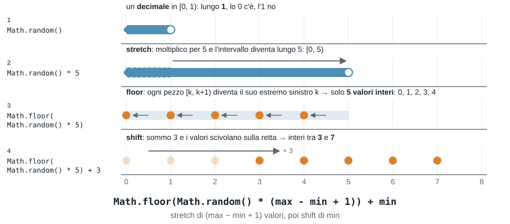

# Esercitazione 4 - 19/10

Argomenti:

- "cosa stampa?", tracciamento delle variabili e ricerca degli errori
- funzioni: senza parametri, con parametri, con `return`

## Indice degli esercizi

| Esercizio | Argomento |
| --------- | --------- |
| [Esercizio 1](#esercizio-1) | Numeri casuali: cosa restituisce |
| [Esercizio 2](#esercizio-2) | Numeri casuali: costruire l'intervallo |
| [Esercizio 3](#esercizio-3) | Numeri casuali: il gioco del dado |
| [Esercizio 4](#esercizio-4) | Numeri casuali e massimo |
| [Esercizio 5](#esercizio-5) | Do-while: cosa succede durante l'esecuzione |
| [Esercizio 6](#esercizio-6) | Do-while: scrivere la condizione |
| [Esercizio 7](#esercizio-7) | Condizioni e variabili: cosa stampa |
| [Esercizio 8](#esercizio-8) | Funzioni senza return |
| [Esercizio 9](#esercizio-9) | Funzioni: return |
| [Esercizio 10](#esercizio-10) | Funzioni e variabili locali |
| [Esercizio 11](#esercizio-11) | Funzioni e controllo dell'input: potenza |
| [Esercizio 12](#esercizio-12) | Funzioni e accumulatori: somma dei pari |
| [Esercizio 13](#esercizio-13) | Funzioni, numeri casuali e do-while |
| [Esercizio 14](#esercizio-14) | Indovina il numero |

## Come si lavora

- Brevi **Recap** pratici, alternati agli esercizi
- Svolgiamo alcuni esercizi insieme (io scrivo il codice live, voi fate lo stesso)
- Esercizi svolti da voi in autonomia
- Domande

Le regole sono le stesse delle volte scorse:

- **provare** prima di rinunciare
- **commenti** dove il codice non parla da solo
- eseguite **sempre** il programma con più valori, compresi i casi "strani" (0, numeri negativi, decimali).

## Esercizio 1

Per ciascuna espressione dite: se i valori sono **interi o decimali**, qual è il **minimo** e il **massimo** possibile (e se il massimo può uscire davvero) e **quanti valori diversi** possono uscire, se sono in numero finito.

**A.** `Math.random() * 10`

**B.** `Math.floor(Math.random() * 10)`

**C.** `Math.floor(Math.random() * 10) + 1`

**D.** `Math.floor(Math.random() * 6) + 1`

**E.** `Math.floor(Math.random() * 10) * 2`

**F.** `Math.floor(Math.random() * 3) - 1`

**G.** `Math.floor(Math.random() * 10 + 1)`

**H.** `Math.floor(Math.random() * 51) + 50`

Poi rispondete:

- se volete un intero tra `50` e `100`, perché si moltiplica per `51` e non per `50`?

<details>
<summary>Soluzione</summary>

| | Tipo | Minimo | Massimo | Valori possibili |
| - | ---- | ------ | ------- | ---------------- |
| A | decimale | `0` | vicino a `10`, ma mai `10` | infiniti |
| B | intero | `0` | `9` | 10 |
| C | intero | `1` | `10` | 10 |
| D | intero | `1` | `6` | 6 |
| E | intero (solo **pari**) | `0` | `18` | 10: `0, 2, 4, ..., 18` |
| F | intero | `-1` | `1` | 3: `-1, 0, 1` |
| G | intero | `1` | `10` | 10 |
| H | intero | `50` | `100` | 51 |

- **Dado:** la D.
- **Equivalenti:** C e G. In G, `Math.random() * 10 + 1` è un decimale in `[1, 11)`, e `Math.floor` lo porta a un intero tra `1` e `10`: lo stesso risultato di C, dove si somma 1 *dopo* aver tolto i decimali. Attenzione invece a E: moltiplicare *dopo* `Math.floor` allarga i valori ma non li rende più numerosi, e restano solo i pari.
- **Perché 51:** i valori tra 50 e 100 sono `100 - 50 + 1 = 51`. Moltiplicando per `50` (e sommando `50`) si otterrebbero interi tra `50` e `99`, e il `100` non uscirebbe mai.

La regola, in generale: per un intero tra `min` e `max` (estremi inclusi) si usa

```js
Math.floor(Math.random() * (max - min + 1)) + min
```

dove `max - min + 1` è **quanti valori** sono possibili, e `min` è il valore da cui si parte.

</details>

## Da `Math.random()` a un intervallo

Un intero casuale in un intervallo si costruisce in due mosse: prima si **allunga** l'intervallo di `Math.random()` (che è lungo 1), poi lo si **sposta** sulla retta. Esempio: un intero tra `3` e `7`.



## Esercizio 2

Usate lo stesso schema della figura precedente negli intervalli seguenti. Completate (al posto di `______`) i due numeri, in modo che l'espressione dia un **intero** nell'intervallo indicato (estremi inclusi):

```js
Math.floor(Math.random() * ______) + ______
```

**A.** tra `0` e `3` (il secondo numero sarà `0`)

**B.** tra `1` e `20`

**C.** tra `3` e `7`

**D.** tra `10` e `20`

**E.** tra `-5` e `5`

<details>
<summary>Soluzione</summary>

Il primo numero è **quanti valori** sono possibili (`max - min + 1`), il secondo è il **minimo**.

**A.** `Math.floor(Math.random() * 4) + 0`: i valori sono 0, 1, 2, 3, quindi 4; il minimo è `0` (e il `+ 0` si può omettere).

**B.** `Math.floor(Math.random() * 20) + 1`: 20 valori, minimo 1.

**C.** `Math.floor(Math.random() * 5) + 3`: i valori sono 3, 4, 5, 6, 7, cioè 5; minimo 3.

**D.** `Math.floor(Math.random() * 11) + 10`: `20 - 10 + 1 = 11` valori, minimo 10.

**E.** `Math.floor(Math.random() * 11) - 5`: `5 - (-5) + 1 = 11` valori, minimo `-5` (si somma `-5`, cioè si sottrae 5).

Errore classico: nell'intervallo 10–20 moltiplicare per `10` (la differenza) invece che per `11`: il `20` non uscirebbe mai.

</details>

## Esercizio 3

**Il gioco del dado.** L'utente sceglie un numero tra 1 e 6, e il programma lancia un dado finché non esce **proprio quel numero**, contando quanti **tentativi** servono. A passi:

**A.** Simulare **un lancio** di dado: salvare il risultato in una variabile `lancio` e stampare `È uscito: ...`.

**B.** Il numero da ottenere è fisso: il `6`. Ripetere i lanci **finché non esce un 6**, stampando ogni lancio e, alla fine, quanti tentativi sono serviti. Completate (al posto di `______`):

```js
let tentativi = ______;
let lancio;
______ {
  lancio = Math.floor(Math.random() * ______) + ______;
  tentativi++;
  console.log("Tentativo", tentativi + ":", lancio);
} ______ (______);
console.log("Ci sono voluti", tentativi, "tentativi");
```

**C.** Ora il numero lo sceglie l'utente: chiedere un **intero tra 1 e 6** (se non lo è, ripetere la domanda) e poi lanciare il dado finché non esce quel numero. Stampare i tentativi alla fine.

Esempio di esecuzione (i lanci cambiano a ogni esecuzione), con `4` come numero scelto:

```text
Tentativo 1: 2
Tentativo 2: 6
Tentativo 3: 4
Ci sono voluti 3 tentativi
```

<details>
<summary>Soluzione</summary>

```js
// A.
let lancio = Math.floor(Math.random() * 6) + 1;
console.log("È uscito:", lancio);

// B.
let tentativi = 0;
let lancio;
do {
  lancio = Math.floor(Math.random() * 6) + 1;
  tentativi++;
  console.log("Tentativo", tentativi + ":", lancio);
} while (lancio != 6);
console.log("Ci sono voluti", tentativi, "tentativi");

// C.
let scelto;
do {
  scelto = Number(prompt("Scegli un numero intero tra 1 e 6:"));
} while (scelto < 1 || scelto > 6 || !Number.isInteger(scelto));

let tentativi = 0;
let lancio;
do {
  lancio = Math.floor(Math.random() * 6) + 1;
  tentativi++;
  console.log("Tentativo", tentativi + ":", lancio);
} while (lancio != scelto);
console.log("Ci sono voluti", tentativi, "tentativi");
```

(Le tre versioni sono alternative: provatele una alla volta, perché dichiarano le stesse variabili.)

**Alternativa con `while`.** Il `while` controlla la condizione **prima** di ogni giro, quindi la variabile deve avere, all'inizio, un valore che faccia entrare nel ciclo (qui `0`, che non è né un `6` né un numero scelto valido):

```js
// B. con while
let tentativi = 0;
let lancio = 0;                                 // valore "finto": diverso da 6
while (lancio != 6) {
  lancio = Math.floor(Math.random() * 6) + 1;
  tentativi++;
  console.log("Tentativo", tentativi + ":", lancio);
}
console.log("Ci sono voluti", tentativi, "tentativi");

// C. con while (stessa idea, anche per il controllo dell'input)
let scelto = 0;                                 // non valido: si entra nel ciclo
while (scelto < 1 || scelto > 6 || !Number.isInteger(scelto)) {
  scelto = Number(prompt("Scegli un numero intero tra 1 e 6:"));
}

let tentativi = 0;
let lancio = 0;                                 // diverso da scelto, che è >= 1
while (lancio != scelto) {
  lancio = Math.floor(Math.random() * 6) + 1;
  tentativi++;
  console.log("Tentativo", tentativi + ":", lancio);
}
console.log("Ci sono voluti", tentativi, "tentativi");
```

Il risultato è lo stesso, ma il `do ... while` è più naturale: non serve inventare un valore iniziale "finto". Un `for` qui non è adatto: non si sa **quanti giri** serviranno.

Il numero casuale va generato **dentro** il ciclo: un nuovo lancio a ogni giro. Il ciclo si ripete finché il lancio è **diverso** dal numero scelto (la condizione descrive il caso in cui si deve continuare). Il `do ... while` è adatto perché il primo lancio va fatto **sempre**, e il contatore `tentativi` aumenta a ogni giro. Nella C ci sono **due** `do ... while`: il primo controlla l'input (intero tra 1 e 6), il secondo fa i lanci. In media servono 6 tentativi, ma può andare molto meglio o molto peggio: eseguite più volte.

</details>

## Esercizio 4

Generare **10 numeri casuali interi tra 50 e 100** (estremi inclusi), stamparli e, alla fine, stampare il **più grande**. A passi:

**A.** Per trovare il più grande si usa un accumulatore, `massimo`. Compilate la tabella per i numeri `7, 3, 9, 4` che arrivano nell'ordine:

```js
let massimo = 0;
// per ogni numero:
if (numero > massimo) {
  massimo = numero;
}
```

| Numero | `numero > massimo` | `massimo` dopo |
| ------ | ------------------ | -------------- |
| 7 | | |
| 3 | | |
| 9 | | |
| 4 | | |

**B.** Scrivete il programma completo: 10 numeri casuali tra 50 e 100, stampati uno per riga, e alla fine il più grande.

<details>
<summary>Soluzione</summary>

**A.**

| Numero | `numero > massimo` | `massimo` dopo |
| ------ | ------------------ | -------------- |
| 7 | `7 > 0`: vero | 7 |
| 3 | `3 > 7`: falso | 7 |
| 9 | `9 > 7`: vero | 9 |
| 4 | `4 > 9`: falso | 9 |

Il massimo si aggiorna solo quando arriva un numero **più grande** di quello salvato.

**B.**

```js
let massimo = 0;                                // più piccolo di qualsiasi valore possibile
for (let i = 1; i <= 10; i++) {
  let numero = Math.floor(Math.random() * 51) + 50;
  console.log(numero);
  if (numero > massimo) {
    massimo = numero;
  }
}
console.log("Il più grande è", massimo);
```

I valori possibili sono `100 - 50 + 1 = 51`: si moltiplica per `51` e si somma `50`. Tutti i numeri sono almeno `50`, quindi `0` va bene come punto di partenza. Il numero casuale va generato **dentro** il ciclo.

**Alternative con `while` e `do ... while`.** Il `for` contiene tre cose: inizializzazione, condizione e aggiornamento. Con `while` e `do ... while` il contatore `i` va dichiarato **prima** del ciclo e aumentato **dentro** il corpo:

```js
// con while
let massimo = 0;
let i = 1;
while (i <= 10) {
  let numero = Math.floor(Math.random() * 51) + 50;
  console.log(numero);
  if (numero > massimo) {
    massimo = numero;
  }
  i++;
}
console.log("Il più grande è", massimo);

// con do ... while
let massimo = 0;
let i = 1;
do {
  let numero = Math.floor(Math.random() * 51) + 50;
  console.log(numero);
  if (numero > massimo) {
    massimo = numero;
  }
  i++;
} while (i <= 10);
console.log("Il più grande è", massimo);
```

Dimenticare `i++` è l'errore classico: il ciclo non finirebbe più. (Le tre versioni sono alternative: provatele una alla volta.) Qui il numero di giri è **noto** (10), quindi il `for` è la scelta più chiara.

</details>

## Esercizio 5

Questo programma chiede un numero positivo finché l'utente non ne inserisce uno:

```js
let x;
do {
  x = Number(prompt("Numero positivo:"));
  console.log("letto", x);
} while (x <= 0);
console.log("fine", x);
```

**A.** L'utente inserisce, nell'ordine, la sequenza `0`, `-2`, `5`. Cosa succede durante l'esecuzione? Per ogni giro dite quale valore viene letto, se il ciclo **continua o si ferma** e perché, e cosa viene **stampato**.

**B.** Stessa domanda con la sequenza `-7`, `0`, `1.5`, `4`. Tutti i numeri della sequenza vengono letti?

**C.** Con quale sequenza di input il ciclo fa **un solo giro**?

<details>
<summary>Soluzione</summary>

**A.** Sequenza `0`, `-2`, `5`:

- **Giro 1**: legge `0`, stampa `letto 0`. La condizione `0 <= 0` è vera: il ciclo **continua**.
- **Giro 2**: legge `-2`, stampa `letto -2`. `-2 <= 0` è vera: **continua**.
- **Giro 3**: legge `5`, stampa `letto 5`. `5 <= 0` è falsa: il ciclo **si ferma**.
- Dopo il ciclo stampa `fine 5`.

**B.** Sequenza `-7`, `0`, `1.5`, `4`:

- **Giro 1**: legge `-7`, stampa `letto -7`. `-7 <= 0` è vera: **continua**.
- **Giro 2**: legge `0`, stampa `letto 0`. `0 <= 0` è vera: **continua**.
- **Giro 3**: legge `1.5`, stampa `letto 1.5`. `1.5 <= 0` è falsa: il ciclo **si ferma**.
- Dopo il ciclo stampa `fine 1.5`.

Il `4` **non viene mai letto**: il programma si ferma al primo valore valido. E `1.5` è accettato, perché si chiede solo un numero positivo, non intero.

**C.** Con qualsiasi sequenza che **inizia** con un numero positivo, ad esempio `8`: il corpo si esegue **sempre una volta**, poi la condizione `8 <= 0` è falsa e il ciclo termina. Stampa `letto 8` e `fine 8`.

Il ciclo continua finché la condizione è **vera**, e la condizione descrive il caso **sbagliato**.

</details>

## Esercizio 6

Per ciascuna richiesta, scrivete la **condizione del `while`**: deve essere vera quando il valore `n` è **sbagliato**, e quindi si richiede l'input.

**A.** Un numero qualsiasi (anche decimale) **maggiore di 0**. Completate: `while (______)`

**B.** Un numero (anche decimale) tra `0` e `1`, estremi **inclusi**. Completate: `while (______ || ______)`

**C.** Un numero **intero**, qualsiasi. Completate: `while (______)`

**D.** Un numero **intero** tra `1` e `12` (estremi inclusi).

**E.** Un numero **intero** tra `1` e `12` (estremi **esclusi**).

Poi per ciascuna controllate la condizione con questi valori: `0`, `1`, `2.5`, `12`, `-3` (quali vengono accettati?).

**Per casa.** Stessa richiesta (scrivete la condizione del `while`) per queste altre situazioni. Controllate ogni condizione con qualche valore valido e qualche valore sbagliato, specialmente agli estremi.

**F.** Un numero **pari** (quindi intero). Suggerimento: `%` dà il resto della divisione. Provate con `0`, `12`, `7`, `2.5`, `-10`.

**G.** Un numero **intero positivo di 3 cifre** (da `100` a `999`). Provate con `99`, `100`, `999`, `1000`, `150.5`.

**H.** Un numero **negativo oppure maggiore di 10**. Attenzione: qui i valori accettati sono due intervalli separati. Provate con `-5`, `0`, `10`, `10.5`, `12`.

**I.** Un numero **intero tra 1 e 100** (estremi inclusi) che **non sia un multiplo di 10**. Provate con `0`, `7`, `10`, `55`, `100`.

**J.** Un numero (anche decimale) compreso tra `-10` e `10` (estremi inclusi) ma **non compreso tra `-1` e `1`** (estremi esclusi, cioè `-1` e `1` sono accettati). Provate con `-10`, `-1`, `-0.5`, `0`, `1`, `5`, `10`, `10.5`.

<details>
<summary>Soluzione</summary>

**A.** `n <= 0`: lo `0` non è maggiore di 0, quindi va scartato. Accetta `1`, `2.5`, `12`.

**B.** `n < 0 || n > 1`. Accetta `0` e `1` (estremi inclusi); scarta `2.5`, `12`, `-3`.

**C.** `!Number.isInteger(n)`. Accetta `0`, `1`, `12`, `-3`; scarta `2.5`.

**D.** `n < 1 || n > 12 || !Number.isInteger(n)`. Accetta `1` e `12`; scarta `0`, `2.5`, `-3`.

**E.** `n <= 1 || n >= 12 || !Number.isInteger(n)`. Accetta solo i valori interi da `2` a `11`: scarta sia `1` sia `12`.

**F.** `!Number.isInteger(n) || n % 2 != 0`. Accetta `0`, `12`, `-10`; scarta `7` (dispari) e `2.5` (non intero). In realtà basta `n % 2 != 0`: per un decimale come `2.5` il resto è `0.5`, quindi già diverso da `0`.

**G.** `n < 100 || n > 999 || !Number.isInteger(n)`. Accetta `100` e `999`; scarta `99`, `1000`, `150.5`.

**H.** `n >= 0 && n <= 10`. Il valore è **sbagliato** quando sta nell'intervallo *tra* i due ammessi, ed essendo un intervallo unico si usa `&&`. Accetta `-5`, `10.5`, `12`; scarta `0` e `10`.

**I.** `n < 1 || n > 100 || !Number.isInteger(n) || n % 10 == 0`. Accetta `7` e `55`; scarta `0`, `10`, `100` (tutti multipli di 10 o fuori intervallo).

**J.** `n < -10 || n > 10 || (n > -1 && n < 1)`. Accetta `-10`, `-1`, `1`, `5`, `10`; scarta `-0.5`, `0` (nel "buco" tra `-1` e `1`) e `10.5` (fuori da `[-10, 10]`). Le parentesi non sono obbligatorie, ma chiariscono che il caso del "buco" è un `&&`.

Per H e J, se l'utente scrive del testo (ad esempio `abc`, che `Number` trasforma in `NaN`) il valore viene **accettato**, perché ogni confronto con `NaN` è `false`: per evitarlo si può aggiungere `|| Number.isNaN(n)` alla condizione.

Un modo per controllare: per ogni condizione provate un valore **sbagliato** (deve dare `true`) e uno **valido** (deve dare `false`), specialmente agli estremi.

</details>

## Esercizio 7

Per ogni programma, dite cosa stampa **senza eseguirlo**.

**A.**

```js
let x = 7;
if (x > 5 && x < 10) {
  console.log("dentro");
} else {
  console.log("fuori");
}
```

**B.** Riguardate il programma A: cosa stampa se `x` vale `10`? E se vale `5`?

**C.**

```js
let x = 7;
if (x < 5 || x > 10) {
  console.log("fuori");
} else {
  console.log("dentro");
}
```

**D.** Che cosa stampano `y` e `z`?

```js
let x = 3;
let y = x > 2 && x < 5;
let z = !y || x == 3;
console.log(y, z);
```

**E.** Quali giri del ciclo fanno `n = n + i`? Cosa stampa?

```js
let n = 0;
for (let i = 1; i <= 5; i++) {
  if (i % 2 == 0 || i == 5) {
    n = n + i;
  }
}
console.log(n);
```

**F.** Compilate la tabella con il valore di `a` e `b` dopo ogni istruzione. Cosa stampa?

```js
let a = 4;
let b = 9;
a = a + b;
b = a - b;
a = a - b;
console.log(a, b);
```

| Passo | Istruzione | `a` | `b` |
| ----- | ---------- | --- | --- |
| 1 | `let a = 4;` | | |
| 2 | `let b = 9;` | | |
| 3 | `a = a + b;` | | |
| 4 | `b = a - b;` | | |
| 5 | `a = a - b;` | | |

<details>
<summary>Soluzione</summary>

**A.** Stampa `dentro`: `7 > 5` è vera e `7 < 10` è vera.

**B.** Con `x = 10`: `10 > 5 && 10 < 10` è `true && false`, quindi `false`, e stampa **`fuori`**. Con `x = 5`: `5 > 5` è falsa, quindi stampa `fuori`. Gli estremi sono **esclusi**, perché si usano `<` e `>` e non `<=` e `>=`. Gli estremi sono il caso in cui si sbaglia più spesso.

**C.** Stampa `dentro`: `7 < 5` è falsa e `7 > 10` è falsa, quindi la condizione è falsa e va nell'`else`. A e C differiscono solo agli **estremi**: con `x = 10` o `x = 5`, A stampa `fuori` e C stampa `dentro`.

**D.** Stampa `true true`: `y` è `true && true`, cioè `true`; `z` è `!true || (3 == 3)`, cioè `false || true`, quindi `true`.

**E.** Stampa `11`. Per `i = 1` e `i = 3` la condizione è falsa. Per `i = 2` e `i = 4` (pari) e per `i = 5` (perché `i == 5`) è vera: `2 + 4 + 5 = 11`.

**F.**

| Passo | Istruzione | `a` | `b` |
| ----- | ---------- | --- | --- |
| 1 | `let a = 4;` | 4 | |
| 2 | `let b = 9;` | 4 | 9 |
| 3 | `a = a + b;` | 13 | 9 |
| 4 | `b = a - b;` | 13 | 4 |
| 5 | `a = a - b;` | 9 | 4 |

Stampa `9 4`: i valori di `a` e `b` sono **scambiati**.

</details>

## Recap 1 · Funzioni

Una **funzione** è un blocco di istruzioni con un nome, che si può **richiamare** quante volte si vuole. Si definisce una volta con `function`; si usa scrivendo il nome con le parentesi.

```js
function messaggio() {                          // senza parametri
  console.log("Benvenuti!");
}

messaggio();                                    // stampa: Benvenuti!
messaggio();                                    // stampa: Benvenuti!
```

**Attenzione:** la sola definizione **non esegue** niente; il codice nella funzione parte quando la si **richiama**.

I **parametri** sono i valori che la funzione riceve; quelli passati alla chiamata sono gli **argomenti**:

```js
function saluta(nome) {                         // con un parametro
  console.log("Ciao " + nome + "!");
}

saluta("Giulia");                               // stampa: Ciao Giulia!
saluta("Marco");                                // stampa: Ciao Marco!
```

Le variabili dichiarate in una funzione (compresi i parametri) esistono **solo dentro** la funzione.

Per far **restituire** un valore si usa `return`:

```js
function quadrato(x) {
  return x * x;
}

let q = quadrato(5);                            // q vale 25
console.log(quadrato(3) + 1);                   // stampa 10
```

- `return` **termina** la funzione e consegna il valore a chi l'ha chiamata, che può salvarlo o usarlo in un'espressione;
- `console.log` invece **stampa** e basta: non restituisce niente (il risultato di una funzione senza `return` è `undefined`);
- le istruzioni scritte dopo un `return` non vengono eseguite.

Due tipi di funzione, quindi: quelle che **fanno qualcosa** (come stampare), e quelle che **calcolano un valore** e lo restituiscono.

## Esercizio 8

**A.** Cosa stampa questo programma? E se si **toglie** l'ultima riga?

```js
function messaggio() {
  console.log("Benvenuti!");
}
console.log("inizio");
messaggio();
console.log("fine");
messaggio();
```

**B.** Scrivere la funzione `ripeti(testo, n)`, che stampa `testo` per `n` volte (una per riga). Ad esempio `ripeti("ciao", 3)` stampa `ciao` tre volte. Poi chiamatela con altri valori, ad esempio `ripeti("ok", 5)`.

<details>
<summary>Soluzione</summary>

**A.** Stampa, nell'ordine: `inizio`, `Benvenuti!`, `fine`, `Benvenuti!`. Il corpo della funzione si esegue a ogni chiamata, nel punto in cui la chiamata compare. Se si toglie l'ultima riga, `Benvenuti!` compare una sola volta; se si tolgono **tutte** le chiamate, la funzione è definita ma **non stampa niente**.

**B.**

```js
function ripeti(testo, n) {
  for (let i = 1; i <= n; i++) {
    console.log(testo);
  }
}
ripeti("ciao", 3);
ripeti("ok", 5);
```

Questa funzione **fa** qualcosa (stampa) e non restituisce niente. I parametri `testo` e `n` esistono solo **durante** la chiamata, e valgono quello che è stato passato. Con due parametri, gli argomenti vanno nello **stesso ordine**: `ripeti(3, "ciao")` non funzionerebbe.

**Alternative con `while` e `do ... while`:**

```js
// con while
function ripeti(testo, n) {
  let i = 1;
  while (i <= n) {
    console.log(testo);
    i++;
  }
}

// con do ... while
function ripeti(testo, n) {
  let i = 1;
  do {
    console.log(testo);
    i++;
  } while (i <= n);
}
```

Le due versioni sono uguali per `n >= 1`, ma **non** per `n = 0`: il `for` e il `while` non stampano niente, il `do ... while` stampa **una volta**, perché esegue sempre almeno un giro prima di controllare la condizione. Per questo problema `for` e `while` sono la scelta giusta.

</details>

## Esercizio 9

**A.** Cosa stampa? Qual è la differenza tra le due funzioni?

```js
function raddoppia(x) {
  return x * 2;
}
function stampaDoppio(x) {
  console.log(x * 2);
}
raddoppia(4);
stampaDoppio(4);
```

**B.** Cosa stampa? Attenzione a quello che succede nella variabile `b`.

```js
function stampaDoppio(x) {
  console.log(x * 2);
}
let b = stampaDoppio(4);
console.log(b);
```

**C.** Il parametro è una copia. Cosa stampano le due `console.log`?

```js
function aumenta(n) {
  n = n + 1;
  return n;
}
let n = 5;
aumenta(n);
console.log(n);
let m = aumenta(n);
console.log(m, n);
```

**D.** Cosa stampa? Quale `return` viene eseguito in ciascuna chiamata?

```js
function segno(x) {
  if (x > 0) {
    return "positivo";
  }
  if (x < 0) {
    return "negativo";
  }
  return "zero";
}
console.log(segno(-3), segno(0), segno(8));
```

<details>
<summary>Soluzione</summary>

**A.** Stampa solo `8`, una volta. `raddoppia(4)` **restituisce** `8`, ma il valore non viene né salvato né stampato, e va perso. `stampaDoppio(4)` invece **stampa** `8`.

**B.** Stampa `8` (durante la chiamata) e poi `undefined`: `stampaDoppio` non ha `return`, quindi `b` vale `undefined`.

**C.** Stampa `5` e poi `6 5`. La funzione lavora su una **copia**: `n` dentro `aumenta` è diverso dalla `n` di fuori, che resta `5`. Nella prima chiamata il risultato viene scartato; nella seconda finisce in `m`.

**D.** Stampa `negativo zero positivo`. A ogni chiamata la funzione si ferma al **primo** `return` raggiunto: per `-3` il primo `if` è falso, il secondo vero e restituisce `"negativo"`. Il `return "zero"` si raggiunge solo se nessuna condizione è vera.

</details>

## Esercizio 10

Scrivere le seguenti funzioni, che **restituiscono** un valore (non lo stampano). Provarle con qualche chiamata, stampando il risultato con `console.log`.

**A.** `maggiore(a, b)` restituisce il maggiore tra due numeri. Ad esempio `maggiore(3, 8)` vale `8`.

**B.** `perimetro(base, altezza)` restituisce il perimetro di un rettangolo; poi usatela per stampare il perimetro di un rettangolo `4 x 6`.

Nelle prossime serve una **variabile locale**: una variabile dichiarata **dentro** la funzione, in cui salvare un risultato intermedio.

**C.** `media_aritmetica(a, b, c, d)` restituisce la media aritmetica di quattro numeri: prima calcolate la loro somma in una variabile locale `somma`, poi restituite la media. Provatela con `31, 27, 18, 25`. Poi provate a stampare `somma` **fuori** dalla funzione: cosa succede?

**D.** `sconto(prezzo, percentuale)` restituisce il prezzo scontato. Calcolate in una variabile locale `risparmio` quanto si risparmia, e restituite `prezzo - risparmio`. Ad esempio `sconto(80, 25)` vale `60`.

**E.** Una festa ha `p` partecipanti e `b` bottiglie di birra, ciascuna da `c` cl. Un bicchiere contiene 100 ml (cioè 10 cl). Scrivete la funzione `festa(p, b, c)` che restituisce **quanti bicchieri** può bere in media ogni partecipante. Usate variabili locali per i passaggi intermedi (ad esempio i bicchieri totali). Provatela con `festa(10, 3, 75)` (risultato `2.25`), `festa(50, 15, 50)` e `festa(3, 2, 75)`.

<details>
<summary>Soluzione</summary>

```js
// A.
function maggiore(a, b) {
  if (a > b) {
    return a;
  }
  return b;
}
console.log(maggiore(3, 8));                    // 8

// B.
function perimetro(base, altezza) {
  return 2 * (base + altezza);
}
console.log("Perimetro:", perimetro(4, 6));     // 20

// C.
function media_aritmetica(a, b, c, d) {
  let somma = a + b + c + d;
  return somma / 4;
}
console.log(media_aritmetica(31, 27, 18, 25));  // 25.25

// D.
function sconto(prezzo, percentuale) {
  let risparmio = prezzo * percentuale / 100;
  return prezzo - risparmio;
}
console.log(sconto(80, 25));                    // 60

// E.
function festa(p, b, c) {
  let ml_totali = b * c * 10;                   // 1 cl = 10 ml
  let bicchieri_totali = ml_totali / 100;       // un bicchiere = 100 ml
  return bicchieri_totali / p;
}
console.log(festa(10, 3, 75));                  // 2.25
console.log(festa(50, 15, 50));                 // 1.5
console.log(festa(3, 2, 75));                   // 5
```

In A, se `a > b` il primo `return` termina la funzione: non serve l'`else`.

Le variabili locali (`somma`, `risparmio`, `ml_totali`, `bicchieri_totali`) **esistono solo dentro la funzione**: in C, scrivere `console.log(somma)` fuori dalla funzione dà `ReferenceError: somma is not defined`. Servono per spezzare il calcolo in passaggi chiari.

</details>

## Esercizio 11

La funzione `potenza(base, esponente)` restituisce `base` elevato a `esponente`, **senza usare `**`**: si moltiplica `base` per se stesso `esponente` volte. Funziona solo se `esponente` è un numero **intero non negativo** (anche `0`).

Scrivere la funzione `potenza`, con una variabile locale `risultato` che accumula i prodotti. Poi scrivere il programma che chiede all'utente la `base` e l'`esponente`: **prima di passare l'esponente alla funzione**, controllare che sia un **intero non negativo**, e se non lo è ripetere la domanda. Alla fine stampare il risultato.

Provatelo con base `2` ed esponente `10` (risultato `1024`), poi con esponente `0` (risultato `1`) e con esponenti non validi: `-3`, `2.5`, `abc`.

Suggerimento: per accumulare un **prodotto**, da quale valore deve partire `risultato`?

<details>
<summary>Soluzione</summary>

```js
function potenza(base, esponente) {
  let risultato = 1;
  for (let i = 1; i <= esponente; i++) {
    risultato = risultato * base;
  }
  return risultato;
}

let base = Number(prompt("Base:"));
let esponente;
do {
  esponente = Number(prompt("Esponente (intero, non negativo):"));
} while (esponente < 0 || !Number.isInteger(esponente));

console.log(base, "^", esponente, "=", potenza(base, esponente));
```

Il controllo sull'input sta **fuori** dalla funzione: la funzione calcola e basta, e il programma principale si assicura di darle valori adatti. L'esponente è sbagliato se è negativo **oppure** non è intero (con `abc`, `Number` dà `NaN` e `Number.isInteger(NaN)` è `false`, quindi viene scartato).

Per un **prodotto**, `risultato` parte da `1` (l'elemento neutro della moltiplicazione), non da `0`, altrimenti resterebbe sempre `0`. L'accumulatore è dichiarato **dentro** la funzione e **prima** del ciclo, e il `return` è **dopo** il ciclo. Con esponente `0` il ciclo non gira e si restituisce `1`, che è il valore giusto. Senza il controllo, con `2.5` il ciclo farebbe 2 giri e darebbe `base * base`, un risultato sbagliato senza alcun errore.

**Alternative con `while` e `do ... while`** per il calcolo (il resto del programma non cambia):

```js
// con while
function potenza(base, esponente) {
  let risultato = 1;
  let i = 1;
  while (i <= esponente) {
    risultato = risultato * base;
    i++;
  }
  return risultato;
}

// con do ... while: SBAGLIATA per esponente 0
function potenza(base, esponente) {
  let risultato = 1;
  let i = 1;
  do {
    risultato = risultato * base;
    i++;
  } while (i <= esponente);
  return risultato;
}
```

La versione con `while` è equivalente a quella con `for`. Quella con `do ... while` dà `potenza(2, 0)` uguale a `2` invece di `1`: il primo giro si fa **sempre**, anche se l'esponente è `0`. Qui il `do ... while` non va bene.

Anche il controllo dell'input si può scrivere con un `while`, partendo da un valore **non valido** per entrare nel ciclo:

```js
let base = Number(prompt("Base:"));
let esponente = -1;                             // non valido: si entra nel ciclo
while (esponente < 0 || !Number.isInteger(esponente)) {
  esponente = Number(prompt("Esponente (intero, non negativo):"));
}
console.log(base, "^", esponente, "=", potenza(base, esponente));
```

</details>

## Esercizio 12

Scrivere la funzione `sommaPari(n)` che **restituisce** la somma dei numeri **pari** compresi tra `1` e `n` (estremi inclusi), cioè `2 + 4 + 6 + ...` fino a `n`. Ad esempio `sommaPari(10)` restituisce `30` (`2 + 4 + 6 + 8 + 10`) e `sommaPari(7)` restituisce `12`.

Poi, nel programma principale: chiedere `n` all'utente e stampare `sommaPari(n)`; stampare inoltre `sommaPari(10) - sommaPari(5)` e dire cosa rappresenta.

<details>
<summary>Soluzione</summary>

```js
function sommaPari(n) {
  let somma = 0;
  for (let i = 1; i <= n; i++) {
    if (i % 2 == 0) {
      somma = somma + i;
    }
  }
  return somma;
}

let n = Number(prompt("n:"));
console.log("Somma dei pari fino a", n, ":", sommaPari(n));
console.log("Somma dei pari da 6 a 10:", sommaPari(10) - sommaPari(5));    // 30 - 6 = 24
```

È l'accumulatore di sempre con un `if` dentro il ciclo, in una funzione: l'accumulatore è dichiarato **dentro** la funzione (e a `0`) e il `return` è **dopo** il ciclo. Se fosse dentro il ciclo, la funzione si fermerebbe al primo giro e restituirebbe sempre `0`. La differenza `sommaPari(10) - sommaPari(5)` è la somma dei pari da 6 a 10 (`6 + 8 + 10 = 24`). `sommaPari(1)` restituisce `0`: nessun numero pari tra 1 e 1.

**Alternative con `while` e `do ... while`:**

```js
// con while
function sommaPari(n) {
  let somma = 0;
  let i = 1;
  while (i <= n) {
    if (i % 2 == 0) {
      somma = somma + i;
    }
    i++;
  }
  return somma;
}

// con do ... while
function sommaPari(n) {
  let somma = 0;
  let i = 1;
  do {
    if (i % 2 == 0) {
      somma = somma + i;
    }
    i++;
  } while (i <= n);
  return somma;
}
```

Anche la versione con `do ... while` dà il risultato giusto per `n = 0` o negativo, ma solo perché il primo giro (con `i = 1`, dispari) non aggiunge niente: è una **coincidenza** di questo problema, non una regola.

**Alternative senza l'`if`.** I numeri pari sono `2, 4, 6, ...`: invece di guardare tutti i numeri e scartare i dispari con l'`if`, si può **partire da `2` e saltare di 2 in 2**, cambiando l'aggiornamento del ciclo (`i = i + 2` al posto di `i++`):

```js
// con for
function sommaPari(n) {
  let somma = 0;
  for (let i = 2; i <= n; i = i + 2) {
    somma = somma + i;
  }
  return somma;
}

// con while
function sommaPari(n) {
  let somma = 0;
  let i = 2;
  while (i <= n) {
    somma = somma + i;
    i = i + 2;
  }
  return somma;
}

// con for, contando i pari: il k-esimo pari è 2 * k, e ce ne sono Math.floor(n / 2)
function sommaPari(n) {
  let somma = 0;
  for (let k = 1; k <= Math.floor(n / 2); k++) {
    somma = somma + 2 * k;
  }
  return somma;
}
```

Tutte le versioni restituiscono lo stesso risultato (`sommaPari(10)` vale `30`, `sommaPari(7)` vale `12`, `sommaPari(1)` vale `0`). La versione con `i = i + 2` fa **la metà dei giri** e non ha l'`if`, ma funziona solo perché sappiamo da dove cominciano i pari; quella con l'`if` è più generale, e si adatta subito a condizioni diverse (ad esempio i multipli di 3, o i numeri che finiscono per 7).

</details>

## Esercizio 13

Scrivere due funzioni:

- `casuale(min, max)`, che **restituisce** un intero casuale tra `min` e `max` (estremi inclusi);
- `leggiIntero(min, max)`, che chiede all'utente un **intero tra `min` e `max`** (estremi inclusi), ripete la domanda finché il valore non è valido e **restituisce** il valore valido.

Poi usarle nel programma principale: chiedere il numero di un mese con `leggiIntero(1, 12)` e stampare un lancio di dado con `casuale(1, 6)`. Provare anche `casuale(50, 100)` e `casuale(-5, 5)`.

<details>
<summary>Soluzione</summary>

```js
function casuale(min, max) {
  return Math.floor(Math.random() * (max - min + 1)) + min;
}

function leggiIntero(min, max) {
  let n;
  do {
    n = Number(prompt("Inserisci un intero tra " + min + " e " + max + ":"));
  } while (n < min || n > max || !Number.isInteger(n));
  return n;
}

let mese = leggiIntero(1, 12);
console.log("Mese:", mese);
console.log("Dado:", casuale(1, 6));
console.log(casuale(50, 100));
console.log(casuale(-5, 5));
```

Il codice è lo stesso che avevamo nei primi esercizi, ma gli estremi sono diventati **parametri**: le funzioni si possono riusare con qualsiasi intervallo. In `leggiIntero` la variabile `n` è dichiarata **prima** del `do` e il `return` è **dopo** il ciclo: la funzione restituisce solo un valore valido.

**Alternativa con `while`.** Si parte da un valore non valido (`NaN`, che non è un intero e quindi fa entrare nel ciclo):

```js
function leggiIntero(min, max) {
  let n = NaN;                                  // non valido: si entra nel ciclo
  while (n < min || n > max || !Number.isInteger(n)) {
    n = Number(prompt("Inserisci un intero tra " + min + " e " + max + ":"));
  }
  return n;
}
```

La funzione si comporta come prima. Il `do ... while` resta più naturale: la domanda va fatta **almeno una volta**, e non serve un valore iniziale inventato.

</details>

## Esercizio 14

**Indovina il numero.** Il programma sceglie un numero segreto **casuale tra 1 e 100** (senza stamparlo!). L'utente prova a indovinarlo: a ogni tentativo il programma risponde `Troppo basso` oppure `Troppo alto`, finché l'utente non indovina. Alla fine il programma stampa in **quanti tentativi** ci è riuscito. Ogni tentativo deve essere un **intero tra 1 e 100**.

Suggerimento: usate le funzioni `casuale` e `leggiIntero` dell'esercizio 13.

<details>
<summary>Soluzione</summary>

```js
function casuale(min, max) {
  return Math.floor(Math.random() * (max - min + 1)) + min;
}

function leggiIntero(min, max) {
  let n;
  do {
    n = Number(prompt("Inserisci un intero tra " + min + " e " + max + ":"));
  } while (n < min || n > max || !Number.isInteger(n));
  return n;
}

let segreto = casuale(1, 100);
let tentativi = 0;
let numero;
do {
  numero = leggiIntero(1, 100);
  tentativi++;
  if (numero < segreto) {
    console.log("Troppo basso");
  } else if (numero > segreto) {
    console.log("Troppo alto");
  }
} while (numero != segreto);
console.log("Indovinato in", tentativi, "tentativi!");
```

Il programma principale è breve, perché i dettagli (come si genera un numero casuale, come si controlla l'input) sono nelle funzioni. Il `do ... while` esterno ripete finché il tentativo è **diverso** dal segreto; `tentativi++` conta i giri. Strategia migliore: dividere a metà l'intervallo a ogni tentativo; con 100 numeri bastano al massimo 7 tentativi.

**Alternativa con `while`** (il resto del programma resta uguale). `numero` parte da `0`, che è diverso da `segreto` (sempre `>= 1`), così si entra nel ciclo:

```js
let segreto = casuale(1, 100);
let tentativi = 0;
let numero = 0;
while (numero != segreto) {
  numero = leggiIntero(1, 100);
  tentativi++;
  if (numero < segreto) {
    console.log("Troppo basso");
  } else if (numero > segreto) {
    console.log("Troppo alto");
  }
}
console.log("Indovinato in", tentativi, "tentativi!");
```

</details>
